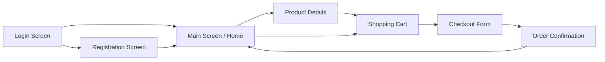

# Hetty’s Shop - Mobile E-Commerce Application

A fully functioning Flutter & Dart e-commerce mobile application built for a university coursework project. The app is ready to run directly in Android Studio or VS Code on Android Emulators, iOS Simulators, Physical Devices, or Web/Desktop.

---

## 📱 Project Architecture & Folder Structure

```
lib/
├── main.dart                          # Root MaterialApp, Routes, Theme configuration
├── models/
│   ├── product.dart                   # Product model (id, name, description, price, image, category, stock)
│   ├── cart_item.dart                 # CartItem model (product, quantity, line total)
│   └── user_profile.dart              # User profile session model
├── data/
│   ├── mock_data.dart                 # 18 sample products, 6 coursework categories, promo banners
│   └── cart_service.dart              # Reactive Singleton Cart & Session state (ChangeNotifier)
├── widgets/
│   ├── product_card.dart              # Product grid card with pricing, rating, stock & quick-add
│   ├── category_chip.dart             # Selectable animated category filter chip
│   ├── promo_banner.dart              # Gradient promotional banner with rounded containers
│   ├── custom_button.dart             # Material 3 reusable styled button with loading state
│   └── custom_text_field.dart         # Form input field with border styles & validation support
└── screens/
    ├── login_screen.dart              # Authentication with email/password form validation
    ├── registration_screen.dart       # Account creation with matching password validation
    ├── main_screen.dart               # Hosts the Bottom NavigationBar (Home, Categories, Cart, Profile)
    ├── home_screen.dart               # Search, promo banners, categories, featured grid
    ├── categories_screen.dart         # 6 coursework categories with toggleable GridView / ListView
    ├── product_details_screen.dart    # Receives Product via route arguments, stock counter & cart actions
    ├── cart_screen.dart               # StatefulWidget shopping cart with real-time total calculations
    ├── checkout_screen.dart           # Shipping & payment Form with strict validation
    ├── order_confirmation_screen.dart # Invoice summary & order receipt
    └── profile_screen.dart            # User profile details, order history & logout
```

---

## 🎓 Lecturer's Required Concepts Checklist

| Lecturer Concept | Implementation Location | Explanation for Student Defense |
|---|---|---|
| **MaterialApp** | `lib/main.dart` | The root widget configuring the application title, theme colors, and named routes table. |
| **Scaffold** | All screens in `lib/screens/` | Provides standard visual layout structure: top `appBar`, content `body`, and `bottomNavigationBar`. |
| **AppBar** | `HomeScreen`, `CategoriesScreen`, `ProductDetailsScreen`, etc. | Displays screen titles, back buttons, and interactive cart badge action icons. |
| **NavigationBar** | `lib/screens/main_screen.dart` | Material 3 navigation bar with 4 destinations: Home, Categories, Cart (with badge), and Profile. |
| **Container** | Used across cards, banners, chips | Provides box styling, rounded borders (`BorderRadius.circular`), shadows, gradients, and padding. |
| **StatelessWidget** | `ProductCard`, `PromoBanner`, `CategoryChip`, `CustomButton` | Used for immutable UI components whose presentation depends entirely on input parameters. |
| **StatefulWidget** | `MainScreen`, `CartScreen`, `CheckoutScreen`, `LoginScreen`, etc. | Used when the screen state needs to mutate dynamically (e.g. cart quantity, tabs, form fields). |
| **Widget** | Typed return throughout all `build()` methods | The foundational building block of the entire Flutter UI hierarchy. |
| **child & children** | Single-child (`Container`, `SizedBox`) & multi-child (`Column`, `Row`, `ListView`, `GridView`) | Defines hierarchy: `child` takes a single widget; `children` takes an array of widgets. |
| **body** | Inside every `Scaffold` | The primary content area occupying the viewport beneath the `AppBar`. |
| **SizedBox** | Used for layout spacing | Provides fixed-size gaps (`SizedBox(height: 16)`) and constraint boxes. |
| **ListView** | `HomeScreen`, `CategoriesScreen`, `CartScreen` | Renders scrollable linear lists (horizontal promo banners, category chips, vertical cart items). |
| **GridView** | `HomeScreen`, `CategoriesScreen` | 2-column responsive product layout using `SliverGridDelegateWithFixedCrossAxisCount`. |
| **Page navigation** | `Navigator.pushNamed`, `Navigator.pop` | Declarative routing between Login, Register, Main, Details, Cart, Checkout, and Confirmation. |
| **Form validation** | `LoginScreen`, `RegistrationScreen`, `CheckoutScreen` | Uses `GlobalKey<FormState>()`, `Form`, `TextFormField`, and `validator: (value) => ...`. |
| **Arguments** | `ProductDetailsScreen`, `OrderConfirmationScreen` | Passed via `Navigator.pushNamed(context, '/product-details', arguments: product)` and extracted via `ModalRoute.of(context)!.settings.arguments`. |

---

## 🛒 Complete Navigation Flow



---

## 🚀 How to Run the Application

### 1. In Android Studio:
1. Open Android Studio.
2. Select **Open** and choose the `e_commence_app` folder.
3. Allow Gradle and Flutter to sync.
4. Select your target device (Android Emulator or physical device).
5. Click the green **Run (▶)** button or press `Shift + F10`.

### 2. From the Terminal / Command Prompt:
```bash
# Verify dependencies
flutter pub get

# Run static analysis (Verifies 0 issues)
flutter analyze

# Run test suite
flutter test

# Launch the app
flutter run
```

---

## 💡 Demo Credentials (Quick Grading)
- **Pre-filled Email**: `hetty.mensah@university.edu`
- **Pre-filled Password**: `password123`
- *Alternatively, click the **"Continue as Guest"** button on the Login screen to immediately explore the shop.*
